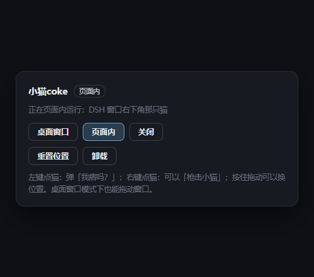
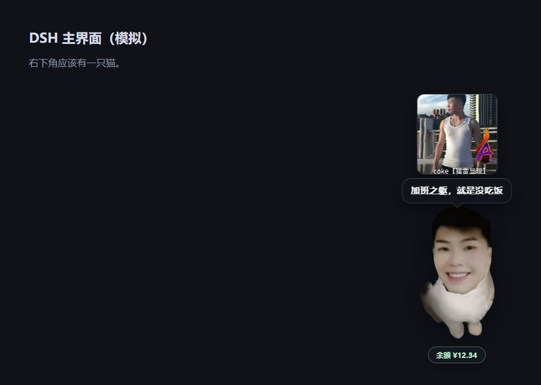
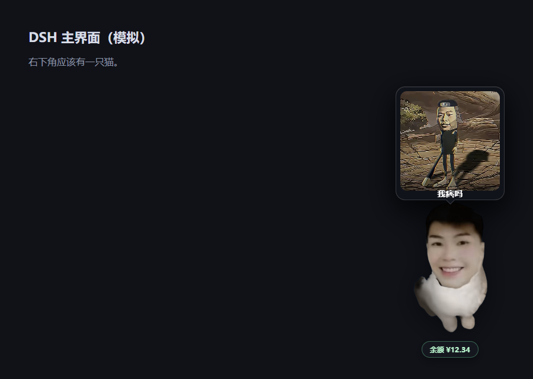
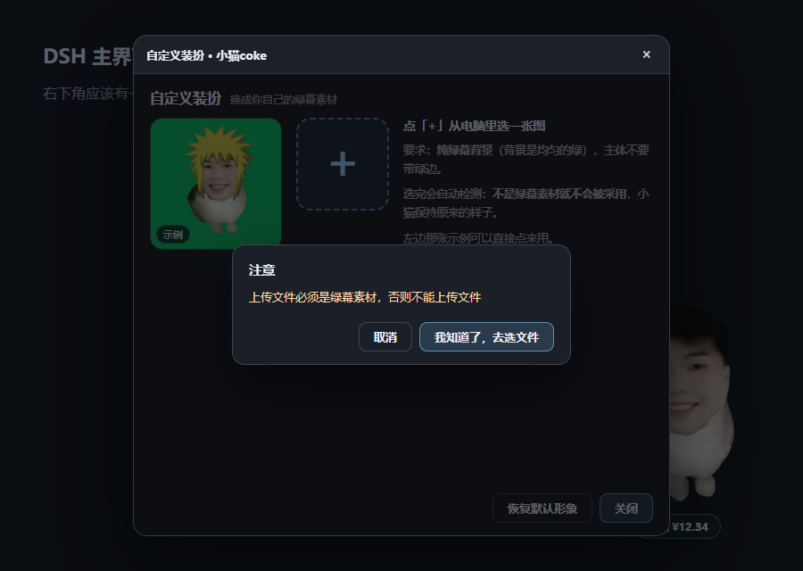

# 小猫coke（`dsh-coke`）

一只会待在**桌面上**（或 DSH 界面里）的猫表情包：绿幕素材抠的图，只留猫身和猫头。

| 操作 | 反应 |
| --- | --- |
| **左键点一下** | 从 **7 句台词**里按权重抽一句（**我痞吗？40%**，其余各 10%），弹气泡 + 放语音 + **Q 弹**地蹦一下再回弹归位 |
| **右键点一下** | 弹出菜单：【**对话**】/【**唱歌**】/【**形态展示**】/【**自定义装扮**】/【**枪击小猫**】 |
| ├ **对话** | 猫头顶冒出一个**空输入框**（和 dsh-pet 一样），打字回车 → **回答进台词气泡**；文字必有，表情包可选 |
| ├ **唱歌** | 猫从身后**掏出麦克风**（摇摇晃晃），然后放歌：**80%** 放第 1 首、**20%** 放第 2 首；再点一次停止，唱完自动收麦 |
| ├ **形态展示** | 猫头顶弹出一张卡片：**随机一张 coke 形态图**（18 张里抽）+ 下面一行「**我痞吗**」，同时放「我痞吗」语音；**1 分钟后自动消失** |
| ├ **自定义装扮** | 弹出一个面板：自带一张示例绿幕素材 + 一个**大号「+」**按钮。点「+」先弹警告，再从电脑里选图；**AI 会先判断是不是绿幕素材，不是就拒绝**，通过则抠图换形象 |
| └ **枪击小猫** | 枪声 + 猫倒下淡出 → **小猫停止运行**（下次开页面也不会自己回来） |
| **点脚下的「查余额」** | 查 DeepSeek 官方余额，结果显示在台词气泡里 |
| **按住拖动** | 换位置（桌面窗口拖的是窗口本身，页面内拖的是那只猫），位置会记住 |
| **设置页 →「小猫coke」** | 桌面窗口 / 页面内 / 关闭 三种模式切换、重置位置、**卸载** |

**默认是桌面窗口模式，而且跟着 DSH 一起自动启动**：重启 DSH，猫就自己出现在屏幕右下角（透明、
置顶、不进任务栏、不抢焦点）。

---

## 一、安装

三种方式，装完都是同一个东西（`~/.dsh/profiles/desktop/node_modules/dsh-coke` +
profile 的 `dependencies` + `dsh.profile.bundles`）：

```powershell
cd C:\Users\jinxi\Documents\deepseek-harness\default-workspace\dsh-coke

node scripts\install.mjs                                   # 开发态：link 到本目录，改代码立刻生效
node scripts\install.mjs --from dist\dsh-coke-0.8.0.tgz     # 模拟市场安装：从打好的包安装
node scripts\install.mjs --print                           # 只看要改什么，不落盘
```

- 改 `package.json` 之前会自动备份成 `package.json.bak-coke-<时间戳>`
- 装完**重启 DSH**：宿主会在启动约 1.5 秒后把桌面窗口拉起来
- 卸载：`node scripts\uninstall.mjs`，或设置页里的「卸载」（两步确认，会连包目录一起删）

> 桌面窗口用的是 `~/.dsh/electron/electron.exe`（dsh-pet 当初下好的那份；可用环境变量
> `COKE_CAT_ELECTRON` 指定别的）。**找不到 Electron 时会自动退回「页面内」模式**并在设置页说明原因，
> 不会出现「装了什么都没有」。

### 上架到插件市场

包名 **`dsh-coke`**（npm 上查过是空的，可用），已按市场要求打包好（`dist/dsh-coke-0.9.0.tgz`）：

| 市场要的 | 本包 |
| --- | --- |
| 包名 / entry id 一致 | `dsh-coke`（`cordis.patch.yml` 里 `id: dsh-coke`） |
| bundle patch | `dsh.bundle.patch = ./cordis.patch.yml` |
| 浏览器半侧 | `dsh.client = { platform: web }` + `exports["./client"]` |
| 图标 | `assets/logo.png`（256×256 PNG） |
| 宿主兼容声明 | `dsh.compatibility.dshReleases`（0.2.0-rc.1 / rc.2 = compatible） |
| 许可证 | MIT + `LICENSE` |
| 装上就能用 | 机器上没有 Electron 会**自动下载**到 `~/.dsh/electron`（约 100MB，下完自动切桌面窗口） |

**四步上线**（前两步要你的 npm / GitHub 账号）：

```powershell
# 1. 登录 npm（一次性）
npm login          # 或 set NPM_TOKEN=...

# 2. 发布（脚本会先 pack 再 publish）
cd C:\Users\jinxi\Documents\deepseek-harness\default-workspace\dsh-coke
node scripts\pack.mjs
node scripts\publish.mjs --yes
```

3. 去 <https://github.com/awesome-dsh-plugin/awesome-dsh-plugin> 提 PR，在插件列表里加一行
   （市场读的就是这份精选列表，通常一天内站点与市场自动收录）：

```markdown
- [dsh-coke](https://www.npmjs.com/package/dsh-coke) — 小猫coke：会待在桌面上的猫桌宠，点一下抽 7 句台词，右键能对话 / 唱歌 / 换装 / 枪击，还能查 DeepSeek 余额。
```

4. 等收录后，在 DSH 的 **插件 → 插件市场** 里搜 `dsh-coke`，点安装 —— 别人就是这么装的。

> 市场安装 = `pnpm add dsh-coke` 到 profile 的 `node_modules`，和本地 `node scripts/install.mjs` 落到同一个位置，
> 所以流程已经全链验证过。没上架前想让别人先用，可以用两种方式：
> - **发 tgz**：把 `dist/dsh-coke-0.9.0.tgz` 发给对方，他执行 `dsh plugin --profile desktop add <路径>/dsh-coke-0.9.0.tgz`
> - **发 GitHub 仓库**：他执行 `dsh plugin --profile desktop add <repo 地址>`


## 二、设置页「小猫coke」

DSH 左下角设置 → 左侧导航里的 **小猫coke**：



- **桌面窗口 / 页面内 / 关闭**：三个模式按钮，当前模式高亮
  - 桌面窗口 = 屏幕角落那个透明置顶小窗（推荐，也是默认）
  - 页面内 = DSH 窗口右下角的浮层（桌面窗口起不来时的退路）
  - 关闭 = 都不显示（被枪击后就是这个状态）
- **重置位置**：回到右下角（页面内立刻生效；桌面窗口下次启动生效）
- **卸载**：第一下变「确认卸载？」，再点才真卸 —— 宿主会先关掉桌面窗口，再把自己从 profile 的
  `dependencies` 与 `dsh.profile.bundles` 里摘掉、删包目录与 `~/.dsh/dsh-coke/`，
  **重启 DSH 彻底消失**

> 卸载会改 profile 的 `package.json`，改前留备份；只动 `dsh-coke` 这一项。

## 三、点一下会说什么
点一下小猫，从这 7 句里按权重抽一句（合计 100）：

| 台词 | 权重 | 素材 |
| --- | --- | --- |
| 我痞吗？ | **40%** | `piqi.wav` |
| 喵喵喵 | 10% | `miao.wav`（特意做响：峰值 0.98 + 软限幅，RMS 0.24→0.45，约 **+5.7dB**） |
| 避我锋芒 | 10% | `bifeng.wav` |
| 约女娲 | 10% | `nvwa.wav` |
| 绝对专注 | 10% | `zhuanzhu.wav` |
| 阿马特拉斯 | 10% | `amatelas.wav` |
| 舒嫩 | 10% | `shunen.wav` |

- 气泡文案跟着音轨走（抽到哪句就显示哪句），不会声画不对
- 素材按需加载（`preload='none'`），7 条不会在挂载时一起下
- 想改概率就改 `lib/client.js` / `pet.html` 里 `VOICES` 的 `weight`（两处是一致的）

## 四、对话

右键 → **对话**，猫头顶冒出一个**空输入框**（没有提示语），直接打字、回车：



形式和 **dsh-pet 的对话一样**：不是聊天面板，而是「贴着猫的小输入框 + 回答直接进台词气泡」。
发出去 → 输入框收起 → 猫说话 → 气泡 9 秒后自己消失。

- **文字回答一定有**；表情包由模型自己决定挑不挑（不挑就纯文字，挑了会显示在文字上方）
- 聊天记忆只带最近 6 句，够接上下文又不会失控
- Esc / 点别处 = 收起输入框；`Shift+Enter` 换行

### 回答是怎么来的（照 dsh-pet 的对话原理）

`lib/coke-voice.js` 是「对话大脑」，`lib/index.js` 的 `POST /chat` 负责串起来，三步跟 dsh-pet 一致：

1. **system = 人设 + 名字 + 当下时间**
   ```
   你是主人桌面上的一只猫，会和主人聊天。说话自然随意、短短一句（20 字以内）……
   你的名字是"小猫coke"。
   【当下】现在是 2026 年 11 月 1 日星期日 11:05，中午。这只是背景，不必刻意报时……
   ```
2. **messages = 最近 6 轮历史 + 当前这句**，temperature 1，45 秒超时，走你当前对话在用的那个模型。
3. **配图可选**：把 18 张表情包（名字 + 描述）附在当前这句后面，让**模型自己决定**要不要挑一张 ——
   挑中就在回复最后另起一行写 `[图:招财小猫]`，宿主把它摘出来当配图，**标记本身不会露在气泡里**；
   模型不写就纯文字。

模型不可用（没配模型 / 超时 / 报错）时**不报错**，给一句自然的短回复兜底（「在的」「喵～」「你说」），
并且 40% 概率随机配一张图 —— 所以任何情况下都有文字回答。

想换性格：改 `lib/coke-voice.js` 里的 `PERSONA`（一句话即可，名字和时间会自动拼在后面）；
想让模型更爱配图/更少配图：改 `imageInstruction()` 的措辞或 `limit`。改完重启 DSH 生效。

## 五、形态展示

右键 → **形态展示**，猫头顶弹出一张卡片：



- 卡片 = **随机一张 coke 形态图**（`assets/coke-01.jpg … coke-18.jpg`，18 张里抽）+ 下面一行「**我痞吗**」
- 同时放「我痞吗」那句语音
- **1 分钟后自动消失**（再点一次会换一张，计时重新开始）
- 卡片和台词气泡用的是同一个「头顶锚点」：猫 Q 弹蹦起来时卡片跟着脑袋抬，不会被顶穿；卡片占着头顶时普通台词气泡会自动收起，不叠在一起
- 桌面窗口模式下，窗口会**临时往上长一截**给卡片让位（贴着屏幕上沿时只长能长的那部分），收起后复原 —— 猫的位置不会跳

停留时长可以改：`~/.dsh/dsh-coke/config.json` 里写 `{ "formMs": 30000 }`（默认 60000）。

## 六、自定义装扮

右键 → **自定义装扮**，弹出的面板（页面里是模态框，桌面模式下是一个独立小窗）：



- 左边是**自带的示例绿幕素材**（点它直接用），旁边是**大号「+」按钮**
- 点「+」先弹警告：**上传文件必须是绿幕素材，否则不能上传文件**，确认后才打开系统的选文件对话框
  （`<input type=file accept=image/*>`，能翻本机所有目录）
- 选完图，**面板里的「AI」先做检测**，不通过就拒绝、形象保持不变；通过才抠图并保存

### 这套「绿幕检测」怎么判的

不是黑盒模型，是四条可解释的硬指标（每条都能给出拒绝理由）：

1. **背景够绿**：边框（最外 4%）的「绿度」`G - max(R,B)` 中位数 ≥ 45
2. **背景够纯**：边框里 ≥ 72% 的像素与主色偏差 ≤ 22（避免「绿色物体 + 别的背景」）
3. **不能整张全绿**：内部绿色像素占比 ≤ 90%（否则是纯色绿图，没有主体）
4. **主体不能太小**：抠出来的前景 ≥ 8%

拒绝时会把具体原因写在面板里，例如：
`✗ 01-idle.png 不是合格的绿幕素材：背景不够绿（绿度中位数 -6，至少要 45）；抠出来的主体太小。已拒绝，形象保持不变。`

### 通过之后

按背景绿度自动定阈值做 key、**去溢色**（绿通道压回 R/B 均值）、裁到内容边界，导出透明 PNG，
写到 `~/.dsh/dsh-coke/skin.png`：

- 页面内的猫、桌面窗口的猫都会立刻换成新形象
- **只换贴图**，点击台词、语音、唱歌、Q 弹、余额、枪击、拖动全都不受影响
- 面板里的「恢复默认形象」删掉这个文件，回到包里自带那张

## 七、桌面窗口是怎么做的

`runtime/desktop-pet/` 是一个**独立的 Electron 小应用**（`package.json` + `main.js` + `preload.js` +
`pet.html`），由宿主用 `child_process.spawn` 拉起来：

- 无边框、`transparent: true`、`alwaysOnTop('screen-saver')`、`skipTaskbar`、`focusable: false`
  —— 不抢焦点、不进任务栏、只在猫身上吃鼠标
- **点击穿透**：窗口默认 `setIgnoreMouseEvents(true, {forward: true})`，渲染端用
  `elementFromPoint` 判断指针是不是落在猫/药丸/菜单上，实时开关
- **拖动**：渲染端按 `screenX/screenY` 算位移 → IPC → `win.setPosition`；松手把位置写进
  `~/.dsh/dsh-coke/desktop-pos.json`，下次启动还原
- **和宿主的双向通道**（关键）：子进程 → 宿主走 stdout 的 JSON 行（`ready` / `call` / `shot` / `log`）；
  宿主 → 子进程走子进程自己开的 **127.0.0.1 迷你 HTTP 口**（端口 + 一次性 token 由 `ready` 行告知）。
  为什么不用 stdin：Windows 的 GUI 进程拿到的 stdin 会**立刻 end**（实测收不到数据），这条路走不通
- 查余额就是这条通道：渲染端 → IPC → 主进程发 `{"kind":"call","path":"/dsh-coke/balance"}` →
  宿主用同一份 `handleRoute` 查完，把结果 POST 回那个本地口 → 渲染端显示
- **宿主没了就自己退出**：每 4 秒 `process.kill(ppid, 0)` 探一次父进程，探不到就 `app.quit()`，
  不会留一个关不掉的透明窗

## 八、自动启动

模式存在 `~/.dsh/dsh-coke/state.json`（`{ "mode": "desktop" | "inline" | "off" }`）：

- DSH 启动 → 插件 `apply()` 起来 → 1.5 秒后读 state：`desktop` 就把窗口拉起来，`inline` 就等页面挂浮层，
  `off` 就什么都不做
- 被枪击 → 宿主把 state 写成 `off`，所以重启也不会复活；要它回来就点设置页的「桌面窗口」

## 九、外观配置

默认值在 `lib/index.js` 的 `DEFAULT_CONFIG`，要改就写 `~/.dsh/dsh-coke/config.json`：

```json
{ "size": 260, "right": 40, "bottom": 28, "bubbleMs": 1800 }
```

| 字段 | 含义 | 默认 |
| --- | --- | --- |
| `size` | 小猫显示高度（px），宽度按贴图比例 | `220` |
| `right` / `bottom` | 距屏幕右边 / 下边像素（桌面窗口）或视口（页面内） | `26` / `20` |
| `bubbleMs` | 台词气泡停留毫秒数 | `1600` |

## 十、素材

| 文件 | 用途 | 说明 |
| --- | --- | --- |
| `assets/cat.png` | 小猫贴图（透明 PNG，414×731） | **绿幕素材**抠的：`greenscreen.py` 用「绿通道优势」`G - max(R,B)` 做遮罩（背景 key≈97、主体≤-18），再去溢色、裁边 |
| `assets/piqi.wav` | 「我痞吗」语音（0.61s） | 来自 `video_20261030_020819.mp3`：删掉 0.65–1.25s 的纯静音，峰值 0.185→0.92 |
| `assets/miao.wav` | 「喵喵喵」（0.99s） | 来自 `video_20261030_113052.mp3`；**故意做响**：峰值 0.98 + `--drive 2.6` 软限幅（RMS 0.24→0.45） |
| `assets/bifeng.wav` | 「避我锋芒」（1.29s） | 来自 `video_20261030_112943.mp3` |
| `assets/nvwa.wav` | 「约女娲」（0.90s） | 来自 `video_20261030_113125.mp3` |
| `assets/zhuanzhu.wav` | 「绝对专注」（0.76s） | 来自 `Screenrecording_20261030_112057.mp3` |
| `assets/amatelas.wav` | 「阿马特拉斯」（1.65s） | 来自 `video_20261030_113155.mp3` |
| `assets/shunen.wav` | 「舒嫩」（0.47s） | 来自 `video_20261030_112905.mp3` |
| `assets/outfit-sample.jpg` | 自定义装扮面板里自带的**示例绿幕素材** | 直接就是一张标准绿幕图（背景绿度 97） |
| `assets/shot.wav` | 枪声（1.32s） | 来自 `video_20261030_020737.mp3`：去掉开头 10ms 静音、峰值 0.288→0.92、尾部 3ms 淡出 |
| `assets/sing1.m4a` | 唱歌第 1 首（157.8s，**80%**） | 来自 `Screenrecording_20261030_113415.mp3` |
| `assets/sing2.m4a` | 唱歌第 2 首（38.1s，**20%**） | 来自 `Screenrecording_20261030_113325.mp3` |
| `assets/logo.png` | 插件图标（256×256） | 从新贴图上裁的头 |
| `assets/coke-01.jpg … coke-18.jpg` | 形态展示用的 18 张 coke 形态图 | 用户提供的原图，缩到长边 480px、JPEG q82（合计 0.52 MB）；素材脚本见开发工作区（未随插件发布） |

### 两句音频的两条管线

**短音效（wav）**：浏览器 Web Audio 解码 → 降混单声道（先判相位）→ 按 10ms RMS 剪静音 →
峰值归一化 → 3ms 淡入淡出 → 16bit 单声道 WAV：

```powershell
node <素材脚本>/export-shot.cjs --in <源头.mp3> --out dsh-coke\assets\piqi.wav
node <素材脚本>/analyze-audio.cjs <源头.mp3>    # 先看包络，确认哪一段有声音
```

**两首歌（m4a）**：微信给的 `Screenrecording_*.mp3` 其实是 **MP4 容器**（720×1584 H.264 + AAC），
所以文件有几十 MB。用 mediabunny 只抽音频轨、原样重封装（copy，不重编码）：

```powershell
node <素材脚本>/extract-audio.mjs <源头.mp3> dsh-coke\assets\sing1.m4a
# 40.7MB → 3.02MB；13.9MB → 0.73MB，时长不变
```

**绿幕抠图**：

```powershell
python <素材脚本>/greenscreen.py [t0] [t1]   # 默认 25 / 70，改阈值可调软边
```

## 十一、接口

宿主半侧一个前缀路由，全部同源：

| 方法 | 路径 | 说明 |
| --- | --- | --- |
| GET | `/dsh-coke/health` | `{ ok: true, name: "coke" }` |
| GET | `/dsh-coke/config` | 外观 + 当前模式 + 桌面窗口状态（`desktop.supported/running/pid`）+ 自定义形象（`skin.custom/url`） |
| POST | `/dsh-coke/mode?to=desktop\|inline\|off` | 切模式（desktop 会拉起窗口，失败自动退回 inline） |
| GET | `/dsh-coke/desktop` | 只看桌面窗口状态 |
| GET | `/dsh-coke/outfit` | 自定义装扮面板页面（iframe 里跑的就是它） |
| GET | `/dsh-coke/chat` | 对话面板页面（内含「coke 语」引擎，完全本地跑，不联网） |
| POST | `/dsh-coke/skin` | 保存自定义形象（body 是 PNG 的 dataURL，上限 12MB） |
| POST | `/dsh-coke/skin?reset=1` | 恢复默认形象 |
| GET | `/dsh-coke/skin.png` | 取当前自定义形象（`no-store`） |
| GET | `/dsh-coke/asset/<文件名>` | 贴图 / 语音 / 枪声 / 歌 / 示例绿幕；扩展名白名单（png/webp/jpg/wav/mp3/ogg/m4a） |
| GET | `/dsh-coke/balance` | DeepSeek 官方余额 |
| POST | `/dsh-coke/uninstall?confirm=1` | 自我卸载（缺 `confirm=1` 直接拒） |

### 余额

`GET https://api.deepseek.com/user/balance`，凭证名 `DEEPSEEK_API_KEY`
（走 `ctx.credentials.resolve`，取不到再退回进程环境变量）。成功：

```json
{ "ok": true, "source": "DeepSeek 官方", "currency": "CNY", "amount": "¥12.34",
  "granted": "2.34", "toppedUp": "10.00", "wallets": [...], "at": "..." }
```

失败一定带原因，**绝不显示伪造的 0**：`credential-missing` / `fetch-error`。
桌面窗口里的余额也走这套（宿主查完通过本地口回给子进程）。

## 十二、实现要点

**宿主半侧** `lib/index.js`（ESM / Cordis 插件）

- `export const name = 'coke'`、`inject: ['webServer']`（其余服务软取）、`apply(ctx)`
- 路由用 `ctx.effect(() => ctx.webServer.register({ kind: 'prefix', ... }))`；关插件时顺手关桌面窗口
- 桌面窗口进程用 `spawn`，`ELECTRON_RUN_AS_NODE` 从子进程环境里**删掉**（否则 Electron 会按 Node 跑）
- 子进程崩溃/秒退会被记录成 `desktop.error`，并在设置页显示

**浏览器半侧** `lib/client.js`（普通副作用脚本，无需打包）

- `window.__ModuleLoader__.load({ id, factory })`；react 只给设置页用
- 浮层挂在 `document.body` 的 shadow root 里，模式变化时自动挂/摘
- Q 弹 = 竖直跳跃（重力 3000px/s²、落地 0.34 衰减）+ 横向欠阻尼弹簧（k=330, c=12.5），纵向 `sy = 1/sx`
- 唱歌：麦克风是**内联 SVG**（不用额外素材），外层 `.cc-mic` 负责「从身后掏出来」的弹出，内层
  `svg` 负责摇头晃脑，两套 transform 分开互不覆盖；选曲就是 `Math.random() < 0.8 ? singA : singB`，
  歌曲用 `preload='none'`，点下去才开始加载
- 自定义装扮：面板是**同源 iframe**（`/dsh-coke/outfit`），保存后 `postMessage` 回来，
  浮层重新拉一次 `/config` 就换图了（带 `?v=mtime`，不吃缓存）

**自定义装扮面板** `runtime/desktop-pet/outfit.html`（页面 iframe 与 Electron 窗口共用同一份）

- 检测与抠图全在 `canvas` 里做：`ImageData` → 绿度 `G - max(R,B)` → 四条指标 → `putImageData` 出透明 PNG
- 保存走两条路：iframe 里 `fetch('/dsh-coke/skin')`；Electron 面板里 `petApi.saveSkin()` → IPC → 主进程写文件
- 桌面模式下这个面板是个**独立的普通窗口**（有标题栏、可缩放），不影响那个置顶透明的小猫窗

**桌面窗口** `runtime/desktop-pet/`

- 窗口宽度按 **贴图真实比例**算（读 PNG 头），换素材不用改代码
- 自测模式：设 `COKE_CAT_SELFTEST_DIR=<目录>` 启动，窗口会自己点一下猫、开菜单、唱歌、查余额，
  每一步截一张图然后退出（开发工作区里的回程测试脚本 就是这么验回程的）

## 十三、已知限制

- 桌面窗口依赖 `~/.dsh/electron`（Electron 43.3.0）。缺失时自动退回页面内模式。
- 只在 Windows 上实测过；macOS / Linux 的路径分支写了但没跑过。
- 余额只认 DeepSeek 官方接口；第三方中转一般没有公开余额接口。
- 「卸载」只删本插件自己，不会回滚 DSH 本体或别的插件。
